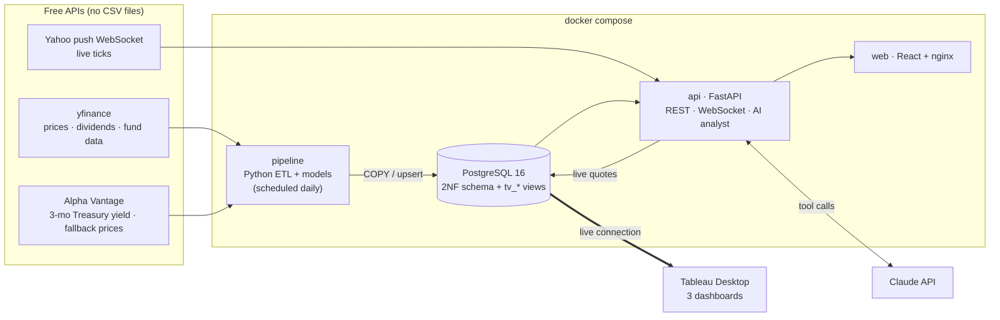

# SPY vs QQQ: a $50,000 allocation pipeline

An end-to-end data science pipeline that answers a retail-investor question with live data:

> **Which split between SPY and QQQ maximises the 5-year Sharpe ratio of a $50,000 portfolio,
> while keeping the 1-year 95% Value-at-Risk within the investor's risk tolerance?**

**Short answer** (13 Oct 2026 run, full details in
[docs/business_recommendation.md](docs/business_recommendation.md)):

- **Stock portion:** tilt it to about 80–85% QQQ / 15–20% SPY. That mix has the best risk-adjusted return, and it holds up across five calibration histories.
- **Size:** set the stock portion by risk tolerance and hold the rest in T-bills. A Moderate investor holds $32.3k QQQ, $5.7k SPY and $12k T-bills.
- **What matters most:** at equal risk, the SPY:QQQ ratio changes the median outcome by only about $600. The stocks-vs-T-bills decision matters far more.
- **A/B test:** 60/40 and 50/50 SPY/QQQ are statistically indistinguishable (bootstrap p = 0.85).

---

## Architecture



| Step | What happens | Code |
|---|---|---|
| **Extract** | Daily OHLCV, adjusted close and dividends since 1999 for SPY, QQQ, DIA, IWM, VTI and ^VIX (yfinance), plus expense ratios, sector weights and top holdings. The 3-month Treasury yield comes from Alpha Vantage. Each source falls back to the other. | [etf_pipeline/extract/](etf_pipeline/extract/) |
| **Transform** | Cleaning, log/simple returns, drawdowns, rolling volatility and Sharpe, trailing dividend yield, forward volatility target, monthly-rebalanced backtests, 1Y/3Y/5Y/10Y/MAX scorecards | [etf_pipeline/transform.py](etf_pipeline/transform.py) |
| **Model** | Monte Carlo (10,000 paths × 21 allocations), Sharpe/Sortino/VaR/drawdown, A/B test, ML volatility model, sensitivity scenarios, recommendations | [etf_pipeline/analytics/](etf_pipeline/analytics/) |
| **Load** | PostgreSQL in second normal form; bulk `COPY` for model outputs; read-only `tableau_reader` login | [db/schema.sql](db/schema.sql), [db/views.sql](db/views.sql) |
| **Serve** | Tableau live connection, plus a FastAPI + React web app with live streaming and an AI analyst | `tableau/` workbook, [api/](api/), [frontend/](frontend/) |

## Requirements → where they're implemented

| Requirement | Implementation |
|---|---|
| Free APIs only, no CSVs | yfinance + Alpha Vantage straight into Postgres. The repo contains no data files. |
| API → Python → Tableau live connection | Pipeline writes to Postgres; Tableau connects live to the `tv_*` views |
| 3 Tableau dashboards | Historical Performance · Risk & Monte Carlo Fan Chart · A/B Comparison & Allocator (workbook in `tableau/`) |
| Statistical model | GBM Monte Carlo, 10k paths, 0–100% QQQ in 5% steps; Sharpe, Sortino, VaR/CVaR, max drawdown ([monte_carlo.py](etf_pipeline/analytics/monte_carlo.py)) |
| A/B test (t-test or bootstrap) | Paired t-test on rolling 3-yr Sharpe, the Newey-West corrected version, a paired t-test on daily returns, and a 1,000-iteration block bootstrap ([ab_test.py](etf_pipeline/analytics/ab_test.py)) |
| Business recommendation | [docs/business_recommendation.md](docs/business_recommendation.md) |
| Python, database, GitHub, Docker | All of the above. `docker compose up` runs everything; CI runs on GitHub Actions. |
| **Custom ML model** | Next-month volatility forecaster: HAR-RV + gradient boosting on its residuals, with walk-forward validation against naive and HAR baselines. Its forecast feeds a Monte Carlo scenario. ([vol_model.py](etf_pipeline/analytics/vol_model.py)) |
| **DBMS in 2NF** | 37 tables + 22 Tableau views; every non-key attribute depends on the whole key (rationale in the header of [schema.sql](db/schema.sql)) |
| **Working AI integration** | Claude (`claude-opus-5-5`) answers questions by calling 8 tools that query the live DB and run new simulations ([analyst.py](etf_pipeline/ai/analyst.py)) |
| **Modern web front-end** | React 18 + TypeScript + Vite + Recharts. Six views, dark mode, a table view behind every chart, colour-blind-validated palette. |
| **Docker / cloud deployment** | 4-service `docker-compose.yml`; the same images deploy to any Docker host (see [Deploying](#deploying-to-the-cloud)) |
| **Data streaming / WebSockets** | Yahoo push WebSocket → FastAPI hub → browser WebSocket (`/ws/quotes`) + `live_quote` table (visible in Tableau) |

## Quick start

**Prerequisites:** Docker Desktop and a free [Alpha Vantage key](https://www.alphavantage.co/support/#api-key).
Optional: an [Anthropic API key](https://console.anthropic.com) for the AI analyst.

```bash
git clone https://github.com/ourshaeem/ETF-Portfolio-Comparison.git
cd ETF-Portfolio-Comparison
cp .env.example .env          # paste your ALPHA_VANTAGE_API_KEY (and ANTHROPIC_API_KEY) into .env
docker compose up --build -d  # first pipeline run takes ~2 minutes
```

| Open | What |
|---|---|
| http://localhost:3000 | Web app |
| http://localhost:8000/docs | API docs (OpenAPI) |
| `localhost:5432`, db `etf`, user `tableau_reader` / `tableau` | Tableau live connection |

Useful commands: `docker compose logs -f pipeline` (watch the run),
`docker compose exec pipeline python -m etf_pipeline run` (re-run now), and more shortcuts in
the [Makefile](Makefile).

> **Never commit `.env`.** It is in `.gitignore`. Each teammate uses their own Alpha Vantage key
> (the free tier allows 25 requests a day; one pipeline run uses about 1).

### Local development (without Docker for the app)

```bash
make venv                     # python3 -m venv .venv && pip install -r requirements-dev.txt
docker compose up -d db       # just Postgres
.venv/bin/python -m etf_pipeline run                      # full pipeline
.venv/bin/python -m etf_pipeline run --steps monte_carlo  # one step
make api-dev                  # FastAPI on :8000 with reload
make web-dev                  # Vite on :5173, proxies /api and /ws to :8000
make test                     # 25 unit tests
```

The EDA notebook is [notebooks/01_eda.ipynb](notebooks/01_eda.ipynb). It reads from Postgres, so run
the pipeline first.

## Project structure

```text
etf_pipeline/            Python package: the whole pipeline
  extract/               yfinance + Alpha Vantage clients (with retries & fallbacks)
  analytics/             metrics, monte_carlo, ab_test, vol_model (ML)
  ai/analyst.py          Claude tool-using analyst
  transform.py           cleaning, features, backtests, scorecards (pure functions)
  pipeline.py            orchestration: extract → transform → ml → ab_test → monte_carlo
  queries.py             read-side service layer shared by the API and the AI tools
  scheduler.py           weekday 22:30 UTC schedule
api/                     FastAPI app + WebSocket quote hub
frontend/                React + TypeScript web app (nginx in production)
db/                      schema.sql (2NF), views.sql (Tableau views), init/ (read-only role)
tableau/                 Tableau workbook (.twb) and dashboard screenshots
notebooks/01_eda.ipynb   exploratory analysis and assumption checks
docs/                    business recommendation
tests/                   pytest suite
```

## Methods in brief

- **Monte Carlo:** correlated geometric Brownian motion calibrated on daily log returns since QQQ's
  1999 inception, covering the dot-com crash, 2008, 2020 and 2022. Every allocation is simulated
  with the same random shocks, so differences between allocations reflect the allocation rather than noise.
  Reported per allocation: median realised 5-year Sharpe and Sortino, percentiles of the 5-year value,
  1-year 95% VaR and CVaR, the distribution of maximum drawdown, and the probability of a loss.
- **Recommendation rule:** take the highest-Sharpe mix whose 1-year VaR is within the tolerance. If no
  all-stock mix fits, hold the max-Sharpe mix plus a T-bill sleeve sized by bisection (Tobin
  separation: cash scales risk without changing Sharpe).
- **Sensitivity:** the frontier is re-run on 15-, 10- and 5-year windows, with an equal-Sharpe
  prior, and with ML-forecast volatility. A minimax-regret view (`tv_mc_regret`) finds the ratio
  that is never far from optimal.
- **A/B test:** the specified paired t-test on overlapping rolling 3-year windows is reported, but it
  is anti-conservative, so the verdict also uses a Newey-West HAC correction and a circular block bootstrap
  of paired daily returns (21-day blocks, 1,000 iterations).
- **ML model:** predicts log realised volatility 21 trading days ahead. Features are 1/5/21/63-day
  realised vol, VIX level and change, momentum and drawdown. Validation is a 5-fold expanding-window walk-forward with
  a 21-day gap, scored on RMSE, MAE, R² and QLIKE. The hybrid beats naive and HAR-only baselines out of sample.

## Database (2NF)

Reference tables (`asset`, `sector`, `security`, `risk_profile`, `data_source`) hold attributes that
depend on a single entity. Fact tables use composite keys whose non-key columns depend on the
*whole* key, for example `price_daily (asset_id, trade_date)` and `mc_fan (run_id, qqq_weight, step)`.
Where an attribute depends on only part of a key, it moves to its own table:

- **Run-level settings** depend on `run_id` only, so they live in `mc_run_config`, not in each
  `(run_id, qqq_weight)` row.
- **Realised volatility** depends on `(asset, date)`, so it lives in `asset_feature_daily`, not in
  `ml_vol_prediction (run, asset, model, date)`.
- **Holding names** depend on the security, so they live in `security`, not in
  `asset_holding (asset, security, as_of)`.

Tableau reads only the `tv_*` views, which always resolve to the latest successful run.

## AI analyst

`POST /api/ai/ask` runs the Anthropic SDK tool runner with `claude-opus-5-5`. Claude can call:

- `get_recommendations`, `get_allocation_frontier`, `get_sensitivity_scenarios`
- `get_ab_test_results`, `get_historical_scorecard`
- `simulate_portfolio` (a new 5,000-path simulation)
- `get_volatility_forecast`, `get_live_quotes`

Every number in an answer therefore comes from the current data. Each question and answer is
logged to `ai_interaction`. The server-side refusal fallback is enabled. Without
`ANTHROPIC_API_KEY`, the endpoint returns a rule-based summary instead.

## Team workflow (everyone commits)

Suggested ownership for a team of six, with each person owning a vertical slice:

| Role | Owns |
|---|---|
| Data engineer | `etf_pipeline/extract/`, `transform.py`, scheduler |
| Database engineer | `db/` (schema, views, roles), `db.py` |
| Quant modeller | `analytics/monte_carlo.py`, `metrics.py`, recommendation logic |
| Statistician / ML | `analytics/ab_test.py`, `analytics/vol_model.py`, EDA notebook |
| BI / Tableau | `tableau/` workbook + the three dashboards, screenshots |
| Full-stack / DevOps | `api/`, `frontend/`, AI analyst, Docker, CI |

Workflow:

- Branch per change (`feat/fan-chart`, `fix/av-fallback`).
- Open a PR into `main`. CI (tests, a live pipeline smoke test and the web build) must pass, and at
  least one teammate reviews.
- Keep commits small, with present-tense messages ("Add block bootstrap for A/B test").
- For the CI smoke test to use Alpha Vantage, add the key as a repository secret named
  `ALPHA_VANTAGE_API_KEY`. Without it, the test falls back to yfinance.

## Deploying to the cloud

The stack is plain Docker Compose, so any Docker host works. For example, a small cloud VM
(AWS Lightsail, DigitalOcean or GCP e2-small):

1. Install Docker.
2. Clone the repo, add `.env`, and run `docker compose up -d`.
3. Open port 3000 for the web app, or put it behind a reverse proxy with TLS. Keep port 5432
   restricted to your team's IPs if Tableau needs to reach it.

Set strong `POSTGRES_PASSWORD` and `TABLEAU_DB_PASSWORD` values before exposing anything publicly.

## Limitations

- Geometric Brownian motion assumes normally distributed returns. Real returns have fat tails
  (see the EDA notebook), so the VaR figures are optimistic lower bounds.
- The expected-return input is the least reliable part of any allocation model. The
  scenarios show how much the "optimal" ratio moves with it.
- Educational project, not financial advice. It ignores taxes and trading costs beyond expense ratios.
